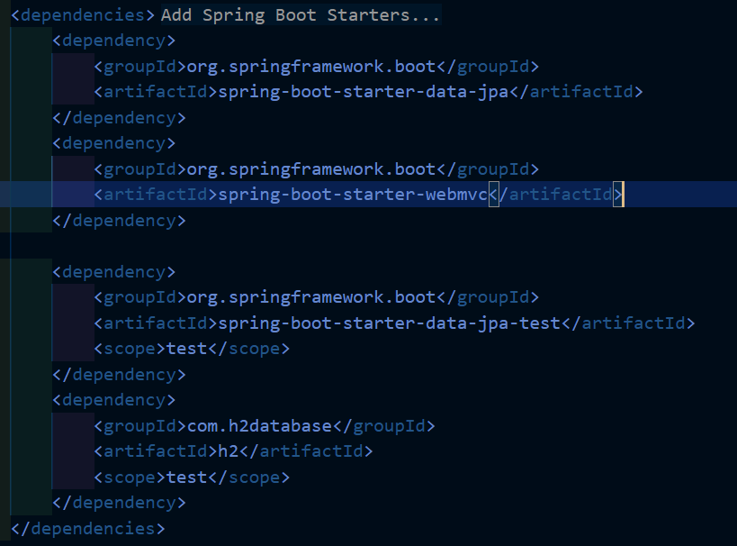
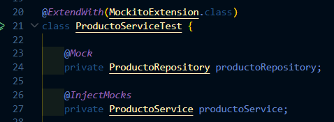
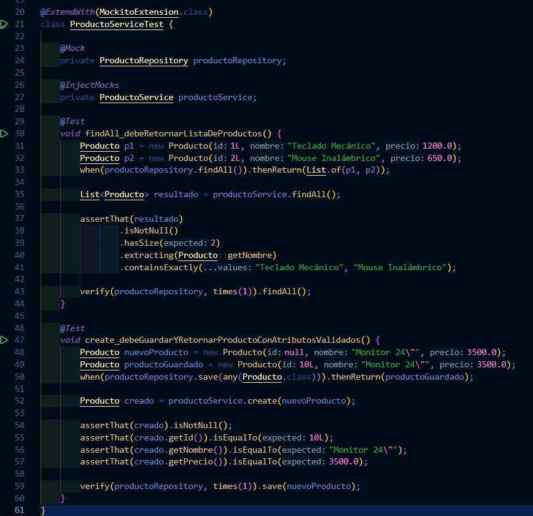
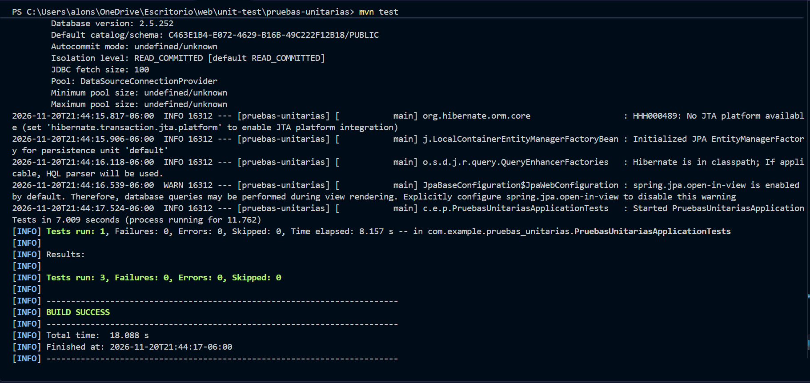

# Pruebas Unitarias en Spring Boot: Explicación y Funcionamiento

Esta práctica consiste en diseñar e implementar pruebas unitarias con **JUnit 5**, **Mockito** y **AssertJ** en una aplicación **Spring Boot** para validar las operaciones de consulta y guardado de datos en la capa de servicios (`ProductoService`), aislando la lógica de negocio de la base de datos.

---

## Cómo funciona la aplicación

El proyecto separa responsabilidades en tres componentes principales para que la lógica de negocio pueda probarse sin depender de una base de datos real:

* **`Producto` (Modelo / Entidad):** Representa el objeto de negocio con sus atributos (`id`, `nombre` y `precio`) y sus constructores, *getters* y *setters*. Está anotada con `@Entity` y `@Id` para que JPA la reconozca cuando se carga el contexto de Spring Boot.
* **`ProductoRepository` (Repositorio):** Es una interfaz que extiende `JpaRepository<Producto, Long>`. Spring Data JPA provee automáticamente métodos estándar como `findAll()` y `save(...)`. En las pruebas unitarias no se conecta a una base de datos real: Mockito simula su comportamiento.
* **`ProductoService` (Servicio / Lógica de negocio):** Recibe `ProductoRepository` por constructor (inyección de dependencias) y concentra las reglas del negocio:
  * **`findAll()`:** delega la obtención de registros a `productoRepository.findAll()` y devuelve la lista resultante.
  * **`create(Producto producto)`:** revisa primero que el nombre no esté vacío ni nulo y que el precio sea mayor que cero; si las validaciones pasan, llama a `productoRepository.save(producto)` para persistir y devolver el producto.

---

## Cómo funcionan las pruebas unitarias (`ProductoServiceTest`)

En lugar de levantar toda la aplicación y consultar una base de datos, la clase de prueba usa **Mockito** para simular el repositorio y **AssertJ** para comprobar los resultados:

* **Aislamiento con `@ExtendWith(MockitoExtension.class)`:** Integra Mockito con JUnit 5 para inicializar los *mocks* e inyecciones de forma ligera y rápida.
* **Simulación con `@Mock` e `@InjectMocks`:**
  * `@Mock` sobre `ProductoRepository` crea un objeto falso (*mock*) del repositorio.
  * `@InjectMocks` sobre `ProductoService` crea una instancia real del servicio y le inyecta el repositorio simulado.
* **Prueba de `findAll`:** Se configura con `when(productoRepository.findAll()).thenReturn(...)` qué lista debe devolver el repositorio simulado. Luego se ejecuta `productoService.findAll()`, se comprueba con `assertThat(...)` (AssertJ) que la lista no sea nula, tenga el tamaño esperado y contenga los productos correctos, y se verifica con `verify(...)` que `findAll()` se haya invocado una vez.
* **Prueba de `create`:** Se prepara un producto de entrada y un producto simulado ya guardado (por ejemplo, con `id` asignado). Se programa `when(productoRepository.save(...)).thenReturn(...)`, se llama a `productoService.create(...)`, se validan sus atributos (`id`, `nombre`, `precio`) con `assertThat(...)` y se verifica la llamada a `save(...)`.

---

## Explicación de las evidencias visuales

### Dependencias de prueba (`dependencies.png`)
Muestra las dependencias configuradas en `pom.xml` para el entorno de pruebas de Spring Boot (JUnit 5, Mockito y AssertJ), permitiendo compilar y ejecutar las pruebas sin tener que escribir código de infraestructura de base de datos para la lógica unitaria.



### Uso de mocks (`mock.png`)
Evidencia la configuración de los objetos simulados con Mockito (`@Mock` e `@InjectMocks`), donde se aísla `ProductoService` de `ProductoRepository` para controlar qué retorna el repositorio en cada escenario de prueba.



### Implementación de `ProductoServiceTest` (`productoServiceTest.png`)
Muestra el código de la clase de pruebas unitarias estructurado bajo el patrón *Arrange - Act - Assert*, probando `findAll` y `create` con aserciones de AssertJ y verificaciones de Mockito.



### Ejecución exitosa con `mvn test` (`build_succes.png`)
Muestra la salida de consola tras ejecutar `mvn test`, confirmando que la compilación y las pruebas se completaron sin errores ni fallos (`BUILD SUCCESS`).



---

## Ejecución y lista de cotejo

Para correr las pruebas desde la carpeta del proyecto Maven:

```bash
mvn test